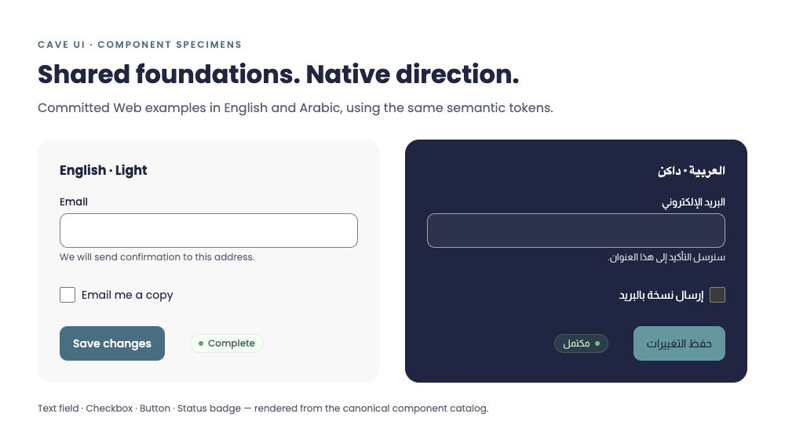

<p align="center">
  <picture>
    <source media="(prefers-color-scheme: dark)" srcset="source/logos/cave-symbol-white.svg">
    
  </picture>
</p>

<h1 align="center">Cave UI</h1>

<p align="center"><strong>Shared design foundations for English and Arabic, on Web and Flutter.</strong></p>

<p align="center">
  
  
  <a href="packages/LICENSE"></a>
  
</p>

<p align="center">
  <a href="https://design.cave.technology">Documentation</a> · <a href="#foundations">Foundations</a> · <a href="#get-started">Get started</a> · <a href="#project-map">Project map</a> · <a href="#engineering-reference">Engineering reference</a>
</p>

---

Cave UI brings design tokens, reusable Web styles and JavaScript helpers, native Flutter widgets, and bilingual guidance into one source repository. Logical properties, locale-aware direction and shared themes support English and Arabic interfaces.



<sub>Web component specimens rendered from committed source; this is a documentation composition, not a product screenshot or Flutter rendering. [Artwork provenance](docs/readme-assets/NOTICE.md).</sub>

## Foundations

| Foundation | In this repository |
| --- | --- |
| **Shared tokens** | Colour, typography, spacing, radii and motion; Light, Dark and Black themes with a System preference |
| **Web** | CSS components and JavaScript helpers with no external runtime dependencies |
| **Flutter** | Native SDK widgets, themes and localization integration |
| **Bilingual guidance** | 15 documented components with English/Arabic HTML, JavaScript and Dart examples |
| **Local exploration** | Component playground, customization controls and sample templates; templates have no backend connections |

## Get started

**Alpha: registry publication and new releases are paused.** Package version `0.1.0-alpha.1` is not published to npm or pub.dev. Use locally built archives or an available archive from the [documentation downloads](https://design.cave.technology/downloads). See the package instructions before installation:

| Package | Purpose | Installation and examples |
| --- | --- | --- |
| `@cave-ui/tokens` | CSS, typed JavaScript/JSON and DTCG subset exports | [Tokens README](packages/tokens/README.md) |
| `@cave-ui/core` | Web styles, locale/theme controller and interaction helpers | [Web README](packages/core/README.md) |
| `cave_ui` | Flutter widgets, themes and localization | [Flutter README](packages/flutter/README.md) |

After installing the Web archive:

```js
import '@cave-ui/core/tokens.css';
import '@cave-ui/core/styles.css';
import { createCave } from '@cave-ui/core';

const ui = createCave({ locale: 'ar-LB', theme: 'system' });
ui.setLocale('en');
ui.setTheme('black');
```

Applications own their content translations and state. The controller supplies built-in UI labels, direction and formatting; it does not translate application content automatically.

## Project map

| Location | Purpose |
| --- | --- |
| `source/tokens.json` | Canonical design values |
| `source/catalog.mjs` · `source/guidance.mjs` · `source/messages.json` | Bilingual component examples, guidance and UI labels |
| `source/components/core.css` | Reusable Web component styles |
| `packages/tokens/` · `packages/core/` · `packages/flutter/` | Package implementations and package-specific licences |
| `src/` · `site/` · `scripts/` | Documentation generation, browser controls and tooling |
| `docs/` | Status, compatibility, migration and accessibility reference |

[Contributing](CONTRIBUTING.md) · [Changelog](CHANGELOG.md) · [Compatibility](docs/COMPATIBILITY.md) · [Migration](docs/MIGRATION.md) · [Accessibility coverage](docs/ACCESSIBILITY.md)

## Licensing and brand separation

**Package code and generated design tokens are MIT licensed.** See [packages/LICENSE](packages/LICENSE) and the licence in each package. Optional bundled open fonts retain their included SIL OFL notices. The UI packages do not load fonts from a network.

Cave logos, icons, patterns and proprietary fonts are excluded from packages. The documentation site's Cave symbol retains separate brand terms; MIT does **not** grant rights to Cave marks. Hero and Blue Ocean are not served by the design site. Consult the separate [Cave Brand guide](https://brand.cave.technology/#licence) for brand use.

## Engineering reference

<details>
<summary><strong>Local setup, validation, documentation behaviour and release reference</strong></summary>

### Build and validate locally

Requires Node 20+ and Flutter 3.35+. The existing repository notes validation with Flutter 3.47.6. These are contributor commands, not checks performed by this README review.

```sh
npm ci
npm test
npm run test:types
npm run build
npx playwright install chromium
npm run test:browser
cd packages/flutter
flutter pub get
flutter analyze
flutter test
```

`npm run build` generates packages, bilingual examples, downloadable archives and `dist/`. `npm run build:packages` updates packages only; `npm run pack:packages` packages already-built output. `npm run serve` serves the generated site.

`npm run build:flutter` compiles the actual Flutter gallery locally, with bundled open fonts and rendering resources. `npm run test:browser:all` checks three browser engines and writes local visual review pages. Run `node tests/flutter-browser.mjs` after building the gallery.

Git is authoritative. Edit canonical sources and rebuild generated outputs; do not overwrite this repository from an external artifact. `source/legacy/` and older component preview folders are historical references, not package inputs.

### Documentation and browser behaviour

The navbar separates documentation language, Web/Flutter and appearance. `?platform=flutter` makes the platform shareable and preserves it across navigation. Preview language is independent of documentation language. Theme changes update previews. Flutter panels provide Dart source; the on-demand gallery runs actual Flutter Web widgets.

Browser checks use local servers. When a sibling brand checkout is present, they also check full-label theme switching in both languages. Set `CAVE_BROWSER_PATH` only for a non-default Chromium executable.

### Publication and hosting

The npm packages are marked `private: true`; Flutter uses `publish_to: none`. Registry names and publisher ownership must be confirmed before a separately authorized release. Package versions and release tags are unchanged by this documentation update.

The checked-in CI workflow validates both platforms and has no package publication, release upload or hosting deployment steps. It is disabled at the time of this documentation review; this change does not enable it.

The Firebase project and Hosting site are `cave-design-system`, with `dist/` as the hosted directory and `design.cave.technology` as the custom domain. Deployment remains paused and requires separate owner approval. Local templates and archives do not establish what revision is deployed.

</details>

[Brand guide](https://brand.cave.technology) · [Cave Shops](https://shops.cave.technology)
